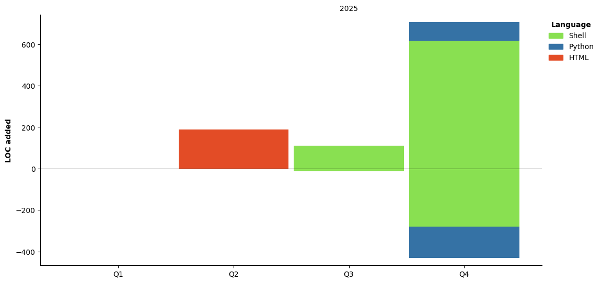

<!-- neofetch terminal-card redesign (2026-11-23). Future-projects list is read from the Obsidian vault (☆Tasks) and refreshed regularly. WakaTime/activity sections below are auto-updated by Actions — do not hand-edit inside the markers. -->

<table style="border-collapse: collapse; border: none; width: 100%;">
<tr style="border: none;">
<td valign="top" style="border: none; padding-right: 24px;">

<pre>
         .
    .         .
  .    _____    .
      /     \
  .  |   ●   |  .
      \_____/
    .         .
         .
</pre>

</td>
<td valign="top" style="border: none;">

<pre>
<b>h4m1dr@physics</b>
─────────────────
<b>Role:</b> Physics-trained Developer
<b>Kernel:</b> Particle Physics (M.Sc.)
<b>Host:</b> Tehran, Iran
<b>Focus:</b> Particle Physics × ML × Automation
<b>Tools:</b> ROOT, Geant4, MadGraph, Pythia
<b>Stack:</b> Python backends, headless crawlers
<b>Languages:</b> Python, TypeScript, Bash
<b>Projects.Featured:</b> MTProMonitorbot, Multifon
<b>Contact:</b> h4m1drn@gmail.com / @h4m1dr
<b>GitHub Stats:</b> Repos 25
<b>Resume:</b> https://h4m1dr.ir
</pre>

</td>
</tr>
</table>

I’m a physics-trained developer exploring the intersection of
**Particle Physics**, **Machine Learning**, and **automation engineering**.

I work with data-heavy pipelines, write **Python backends**,
build **headless crawlers**, design **custom ML workflows**,
and often experiment with tools used in high-energy physics simulations.

I enjoy turning complex systems into minimal, elegant solutions
whether it's parsing messy data, optimizing models,
or crafting advanced AI-driven workflows through deep prompt-engineering. ⚡


---

## ⭐ F4V0R173 73CH
Tools, languages, and other things that I like to work with.

<table>
  <tr>
    <td align="center" width="96">
      
      <br />Node.js
    </td>
    <td align="center" width="96">
      
      <br />Python
    </td>
    <td align="center" width="96">
      
      <br />Bash
    </td>
    <td align="center" width="96">
      
      <br />Linux
    </td>
    <td align="center" width="96">
      
      <br />Docker
    </td>
    <td align="center" width="96">
      
      <br />Cloudflare
    </td>
    <td align="center" width="96">
      
      <br />MTProto
    </td>
  </tr>
</table>

---

## 📌 P1NN3D PR0J3CT5

- **MTProMonitorbot-Node** – A modern MTProto proxy monitoring bot  
- **MTProMonitorbot-python** – Python version with auto-installer & scripts  
- **Multifon** – Lightweight Telegram / MTProto utility toolkit  
- More tools and optimizations coming soon…

---

## 📄 R35UM3

My full academic résumé lives at **[h4m1dr.ir](https://h4m1dr.ir)** — the projects below are the code side of it. (The page itself is still being fixed up.)

---

## 📊 PR0DUC71V17Y 4N4LY71C5
Powered by **WakaTime** + GitHub Actions (auto-updated daily)

### ⏰ Coding Activity (This Week)

<!--START_SECTION:waka-->


**🐱 My GitHub Data** 

> 📦 675 Bytes Used in GitHub's Storage 
 > 
> 🏆 0 Contributions in the Year 2026
 > 
> 🚫 Not Opted to Hire
 > 
> 📜 7 Public Repositories 
 > 
> 🔑 0 Private Repositories 
 > 
**I'm a Night 🦉** 

```text
🌞 Morning                2 commits           █░░░░░░░░░░░░░░░░░░░░░░░░   02.86 % 
🌆 Daytime                24 commits          █████████░░░░░░░░░░░░░░░░   34.29 % 
🌃 Evening                21 commits          ████████░░░░░░░░░░░░░░░░░   30.00 % 
🌙 Night                  23 commits          ████████░░░░░░░░░░░░░░░░░   32.86 % 
```
📅 **I'm Most Productive on Wednesday** 

```text
Monday                   4 commits           █░░░░░░░░░░░░░░░░░░░░░░░░   05.71 % 
Tuesday                  5 commits           ██░░░░░░░░░░░░░░░░░░░░░░░   07.14 % 
Wednesday                34 commits          ████████████░░░░░░░░░░░░░   48.57 % 
Thursday                 21 commits          ████████░░░░░░░░░░░░░░░░░   30.00 % 
Friday                   1 commits           ░░░░░░░░░░░░░░░░░░░░░░░░░   01.43 % 
Saturday                 4 commits           █░░░░░░░░░░░░░░░░░░░░░░░░   05.71 % 
Sunday                   1 commits           ░░░░░░░░░░░░░░░░░░░░░░░░░   01.43 % 
```


📊 **This Week I Spent My Time On** 

```text
🕑︎ Time Zone: UTC

💬 Programming Languages: 
Other                    5 hrs 33 mins       █████████████████████████   100.00 % 

🔥 Editors: 
Chrome                   5 hrs 33 mins       █████████████████████████   100.00 % 

🐱‍💻 Projects: 
h4m1dr                   5 hrs 33 mins       █████████████████████████   100.00 % 

💻 Operating System: 
Windows                  5 hrs 33 mins       █████████████████████████   100.00 % 
```

**I Mostly Code in Python** 

```text
Python                   3 repos             ████████████░░░░░░░░░░░░░   50.00 % 
Shell                    3 repos             ████████████░░░░░░░░░░░░░   50.00 % 
```


**Timeline**




 Last Updated on 02/03/2026 19:11:46 UTC
<!--END_SECTION:waka-->

---

## 📈 W33KLY G17HUB 4C71V17Y

Real GitHub contributions for the last 7 days (commits, PRs, issues, etc.)

<!--START_SECTION:ascii-week-->

# Weekly GitHub Activity (contributions)

Thu    7 | ██████████████████████████████
Fri    0 | ░░░░░░░░░░░░░░░░░░░░░░░░░░░░░░
Sat    0 | ░░░░░░░░░░░░░░░░░░░░░░░░░░░░░░
Sun    0 | ░░░░░░░░░░░░░░░░░░░░░░░░░░░░░░
Mon    2 | ████████░░░░░░░░░░░░░░░░░░░░░░
Tue    6 | █████████████████████████░░░░░
Wed    5 | █████████████████████░░░░░░░░░

<!--END_SECTION:ascii-week-->

---

## 📉 M0N7HLY G17HUB 4C71V17Y (L457 12 M0N7H5)

Real GitHub contributions aggregated monthly.

<!--START_SECTION:ascii-month-->

# Monthly GitHub Activity (last 12 months)

Jan 2025 | ░░░░░░░░░░░░░░░░░░░░░░░░░░░░░░     0
Feb 2025 | █████████░░░░░░░░░░░░░░░░░░░░░     4
Mar 2025 | ░░░░░░░░░░░░░░░░░░░░░░░░░░░░░░     0
Apr 2025 | ████░░░░░░░░░░░░░░░░░░░░░░░░░░     2
May 2025 | ░░░░░░░░░░░░░░░░░░░░░░░░░░░░░░     0
Jun 2025 | ░░░░░░░░░░░░░░░░░░░░░░░░░░░░░░     0
Jul 2025 | ████░░░░░░░░░░░░░░░░░░░░░░░░░░     2
Aug 2025 | ░░░░░░░░░░░░░░░░░░░░░░░░░░░░░░     0
Sep 2025 | ████░░░░░░░░░░░░░░░░░░░░░░░░░░     2
Oct 2025 | ░░░░░░░░░░░░░░░░░░░░░░░░░░░░░░     0
Nov 2025 | ████████████████░░░░░░░░░░░░░░     7
Dec 2025 | ██████████████████████████████    13

<!--END_SECTION:ascii-month-->

---

## 📫 H0W 70 R34CH M3

* Email: **[h4m1drn@gmail.com](mailto:h4m1drn@gmail.com)**
* Telegram: **[@h4m1dr](https://t.me/h4m1dr)**
* GitHub: **@h4m1dr**

---

## 🎯 FUTUR3 PR0J3CT5 — from my Obsidian

This list is read from my Obsidian vault and refreshed regularly. Percentages are my current progress estimate from the vault's checklists and the server's real state.

| Project | Progress | Notes |
|---|---|---|
| **Agent on my own server** (nullclaw → nanobot → Hermes) | `█████████░░░░░░░░░░░░░` 30% | Prerequisites done (null domain + SSL, Docker conflicts, limits); monitoring backup + the agent itself still to do |
| **9Router × OmniRouter** | `████████████░░░░░░░░░░` 40% | 9Router is live (0.5.119); OmniRouter trial, combo builds and the Gemini 403 fix still pending |
| **Podcast pipeline** (NotebookLM / on-server) | `███░░░░░░░░░░░░░░░░░░░` 10% | Idea stage — trying NotebookLM, Colab from the phone, and podcasting on the server |
| **Windows setup** | `████████████████░░░░░░` 53% | 8 of 15 apps/config done (Proxifier, Office, VM/Linux, Telegram/Discord, network, download manager…) |

**Goals, not code:** learning English for career + migration, and daily energy / health — ongoing.

**Roadmap checklist:**
* [ ] Add dashboard monitoring UI
* [ ] Release full MTProto monitoring suite
* [ ] Publish Linux helper scripts
* [ ] Improve documentation for all public repos
* [ ] Expand automation tools

---

## 🧿 PR0F1L3 V13W5


---
